# Landing page templates — shortlist for Nova

**Date:** 28 October 2026 · **Purpose:** pick a template (or a block library) to shape Nova's marketing page.
**Method:** every demo below was opened in a real browser and screenshotted on 28 October 2026. Screenshots live in `docs/landing-templates/`.

## The short answer

| # | Template | Cost | Stack | Nova fit | Use it for |
| --- | --- | --- | --- | --- | --- |
| 1 | **Tailark** (Veil blocks) | Free (MIT), Pro optional | shadcn + Tailwind, any React | ★★★★★ | Grafting better sections into the page Nova already has |
| 2 | **Cruip Simple Light** | Free | Next.js + a Vite build | ★★★★☆ | A free, complete page structure to copy wholesale |
| 3 | **Magic UI Pro — SaaS / AI Agent** | $199 lifetime | Next + Tailwind + Motion | ★★★★★ (paid) | The best-looking paid AI landing; buy-one-thing option |
| 4 | **Orion** (shadcnstudio) | Pro plan | Next + Astro | ★★★★★ (palette) | Studying the warm-cream + orange AI-agent treatment |
| 5 | **shadcnstore dashboard + landing** | Free (MIT) | **Vite** + Next, TW4, shadcn v3 | ★★★★☆ | Closest stack to Nova; free app + marketing page |
| 6 | **Solaris** (shadcn.io) | Pro | Next + shadcn | ★★★☆☆ | Dark "AI workforce" content architecture |
| 7 | **Velora UI** | Free (MIT) | Next 16 + TW4 + Motion | ★★★☆☆ | Animated component/blocks library, MIT |
| 8 | **ChatDeck** | Free (MIT) | Next 16 + React 19 + TW4 | ★★★☆☆ | A plain, safe SaaS skeleton |
| 9 | **Launch UI** | Free (MIT) | React + Tailwind | ★★☆☆☆ | Technical/dev-tool sections (terminal, code, SDK) |
| 10 | **shadcn landing page** (leoMirandaa) | Free (MIT) | **Vite** + shadcn | ★★☆☆☆ | Free Vite skeleton, needs a full re-theme |
| 11 | **Tailwind Plus** | $299 one-off | any | ★★★★☆ (paid) | Reference-grade marketing sections, no whole page |

Scores weigh Nova's brand rules (warm paper base, one ember accent, serif display, generous space) and the repo's stack (Vite 7, React 19, Tailwind 4, Radix, wouter — **no Next.js, no Motion**).

---

## 1. Tailark — best fit overall

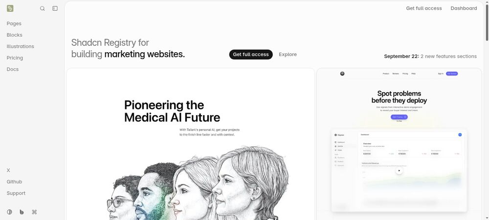
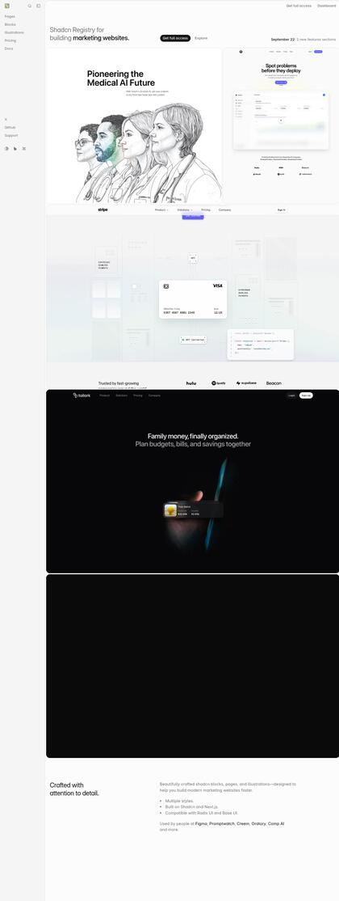

Free, MIT-licensed library of 300+ marketing blocks across four themes (Quartz, Dusk, Mist, Veil); the open-source repo ships two style kits — **Veil** (clean light) and **Dusk** (dark). It is shadcn-native and installs block-by-block through the shadcn registry, so nothing about Nova's existing page or brand tokens has to move. [^1]

**Why it fits:** Nova's page already has the right bones but generic middle sections. Tailark is the cheapest way to upgrade exactly those — feature bento, integrations/logo row (Nova already lists Telegram, GitHub, Gmail, Vercel), "how it works" steps, FAQ accordions — while keeping the working hero and the product capture.

**Friction:** the blocks assume Tailwind 4 + Radix, which Nova has; some variants expect `motion` for reveals, which would be a new dependency.

---

## 2. Cruip Simple Light — best free complete page

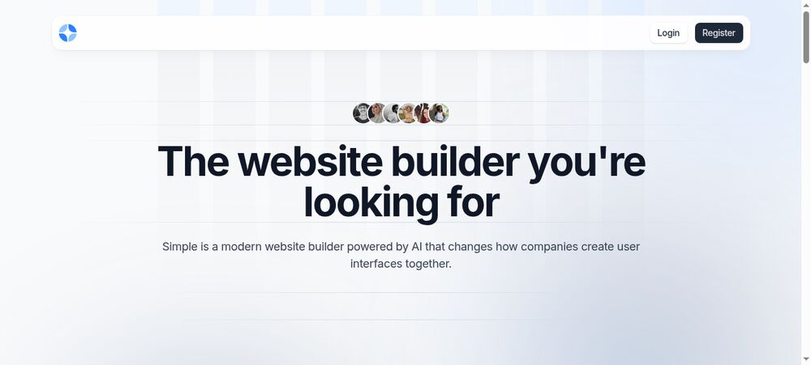
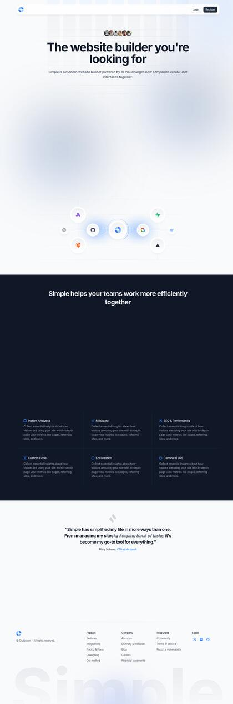

4.5k stars, free, and one of the most-forked SaaS landing templates on GitHub. Ships both a Next.js and a React + Vite version, with hero, feature grid, testimonial carousel, pricing, newsletter and footer. [^2]

**Why it fits:** structurally it is almost the same page Nova ships today — centred hero, wide product screenshot, section rhythm, one dark testimonial band with a warm spotlight that would take Nova's ember accent beautifully. Accent is a token swap; typography and spacing already behave like Nova's brand rules.

**Friction:** default palette is cool sky-blue; the Next version needs its `Link`/`Image` swapped for wouter/plain tags (use the Vite build to skip that).

---

## 3. Magic UI Pro — SaaS + AI Agent templates

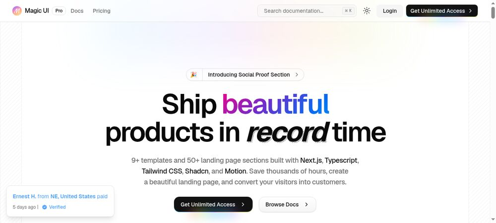
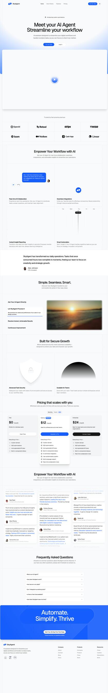

$199 one-off unlocks every Magic UI Pro template plus 150+ components (the free components are MIT). Two relevant templates: **SaaS** (the polished AI-first marketing page) and **AI Agent** (9 sections: hero, logos, feature bento, testimonials, pricing, FAQ, CTA). [^3]

**Why it fits:** this is the design quality most people mean by "AI landing page": soft light gradients, one accent, a bento that explains what the agent actually does, motion used for reveals rather than decoration. The AI Agent template's section list maps almost one-to-one onto Nova's story.

**Friction:** paid, Next.js, and it leans on `motion`. If you buy one thing, buy this.

---

## 4. Orion (shadcnstudio) — the palette twin

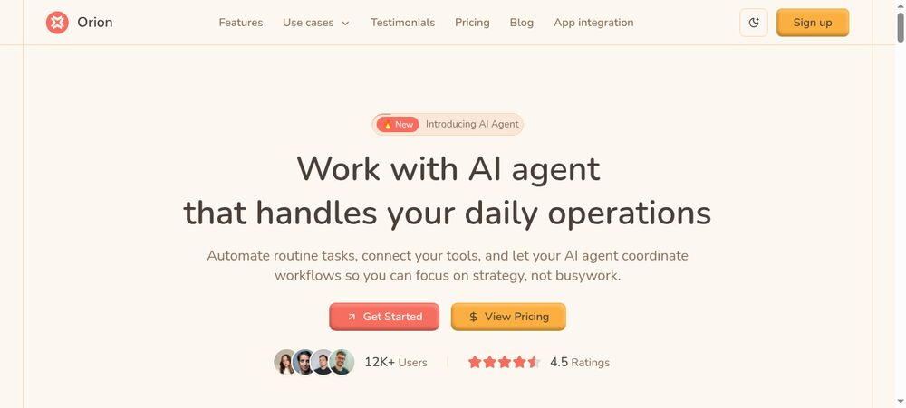
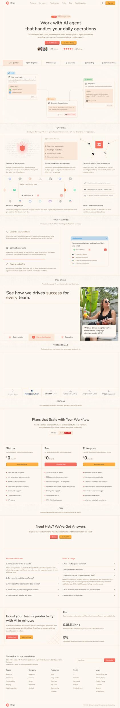

An AI-agent landing page from the shadcnstudio Pro library, in Next.js and Astro editions. Hero, trust band, feature trio, use-case row with photo, testimonial wall, three-tier pricing, FAQ, blog, app-integration section. [^4]

**Why it fits:** it is the closest thing on the internet to Nova's brand applied to an AI-agent product — cream/paper background, orange accent used sparingly, generous whitespace, serif-adjacent headings. Worth studying section-by-section even if you never buy it, because it answers "what does a warm, calm agent page look like end to end".

**Friction:** paid, Next/Astro only, and the copy is generic enterprise-agent voice.

---

## 5. shadcnstore dashboard + landing (Vite) — same stack as Nova

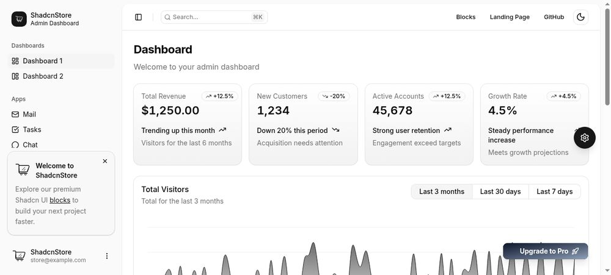
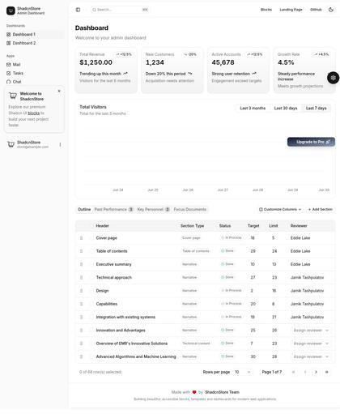

Free and MIT: a dashboard plus a marketing landing page, in **React + Vite** *and* Next.js, on shadcn/ui v3, Tailwind 4, with live theme customisation. [^5]

**Why it fits:** it is the only free option here whose React build is Vite + Tailwind 4 like Nova's, so sections transplant without a framework port. It also pairs a marketing page with an app shell, which is the shape Nova's product already has.

**Friction:** built on Base UI rather than Radix (an extra dependency, and a different composition API), and the page reads as "SaaS admin dashboard" rather than a personal computer.

---

## 6. Solaris (shadcn.io) — dark agent architecture

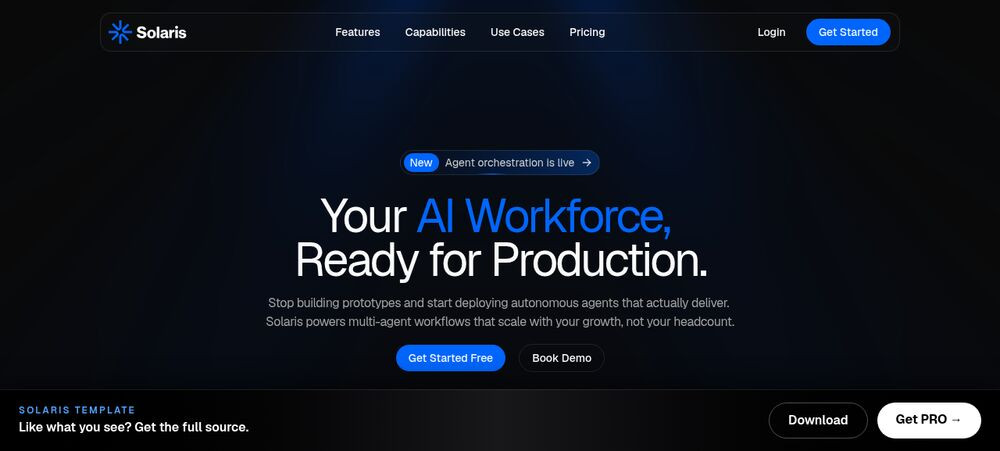
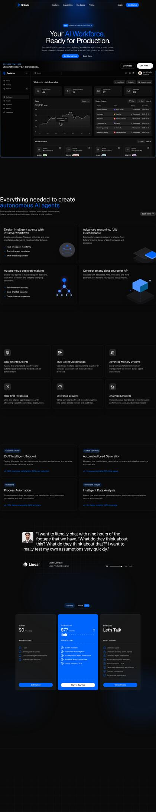

"Your AI workforce, ready for production." Dark navy, agent-orchestration headline, real dashboard capture, capability rows, use cases, pricing. Free to preview; code requires shadcn.io Pro. [^6]

**Why it fits:** the content architecture — what the agent is, what it does on screen, proof — is the strongest match to Nova's product of anything here, and Nova's brand kit already defines a warm-charcoal dark mode (`--nova-night`).

**Friction:** cold navy/blue is the opposite of Nova's warm paper base; only worth it as a dark-mode direction, re-tinted to ember.

---

## 7. Velora UI — free animated library

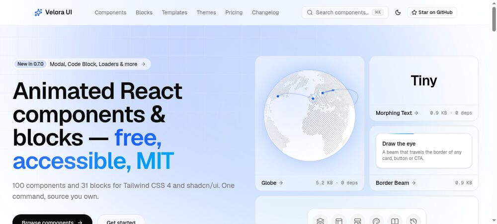
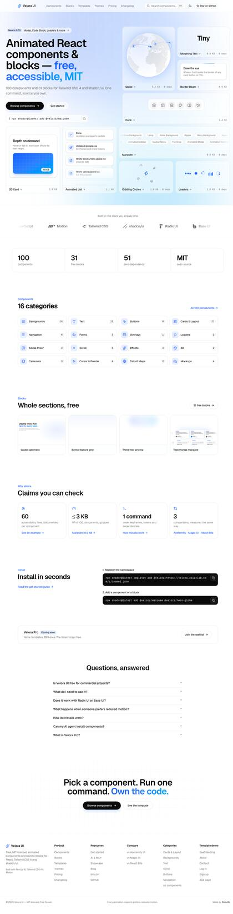

Free MIT: 100 animated shadcn components, 31 blocks, and a complete multi-page template (home, pricing, blog, auth, changelog, 404) on Next 16 + Tailwind 4 + Motion. Reduced-motion and keyboard behaviour are handled in the components themselves. [^7]

**Why it fits:** if the goal is a livelier hero — border beams, aurora background, logo marquees — this is the free source with the most taste. Install individual components rather than the site.

**Friction:** cool lavender palette in the demos; needs `motion` and Next-style routing.

---

## 8. ChatDeck — plain, safe, free

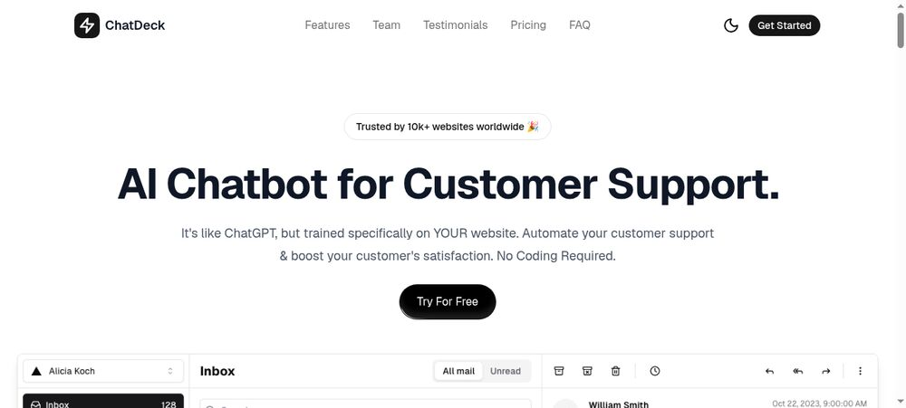
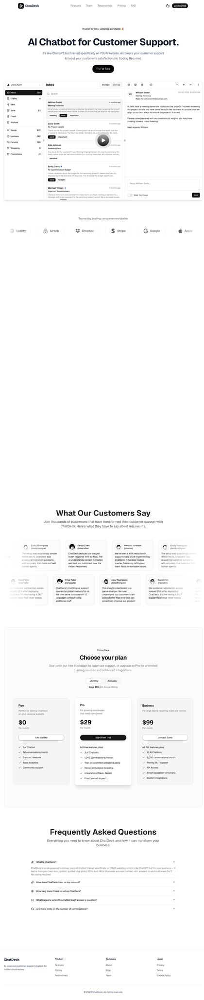

Free MIT SaaS landing page: sticky nav, hero with a live product capture, logo cloud, dedicated video section, feature grid, testimonial wall, pricing, FAQ. Next.js 16, React 19, Tailwind 4, shadcn's `base-nova` style. [^8]

**Why it fits:** conventional and well documented, so it stays out of the way of a warm palette. The video-section slot is useful for an agent demo.

**Friction:** no motion, Next-only, and the design is deliberately unremarkable.

---

## 9. Launch UI — for the technical sections only

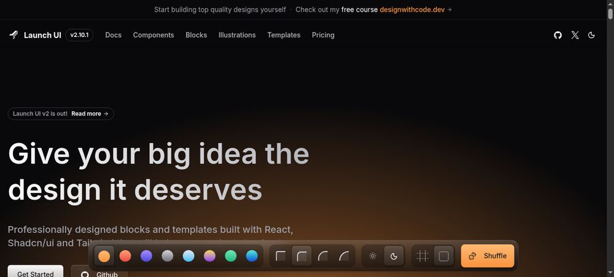
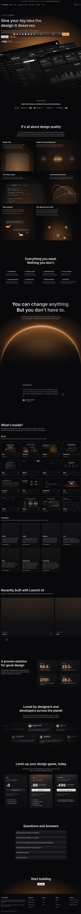

Free MIT with a very large section library — terminals, code blocks, SDK quickstarts, changelogs — in a dark, neon style.

**Why it fits:** almost nothing, visually: it reads cold and shouty against Nova's "warm quiet room" rule. It earns a place because Nova has an **API docs** nav item and developer material, and this is the best free library of those sections.

**Friction:** would need re-tinting or a separate dark surface.

---

## 10. shadcn landing page (leoMirandaa) — free and Vite-native

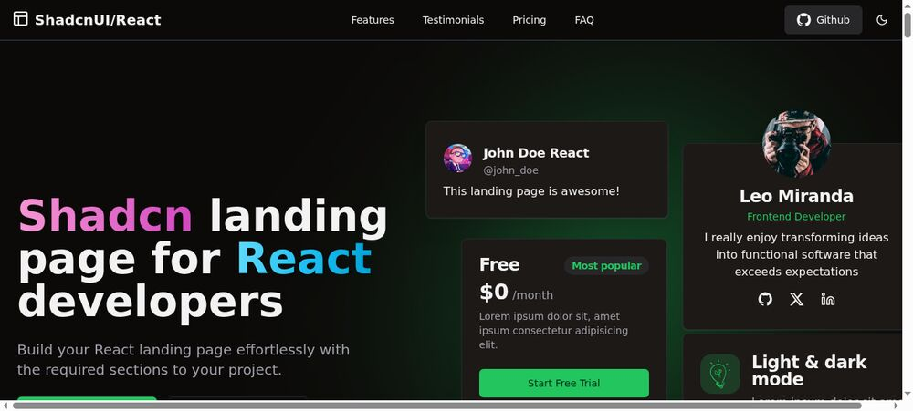

1.9k stars, MIT, **built with Vite** and shadcn/ui, with hero, features, testimonials, pricing, FAQ and contact sections. [^9]

**Why it fits:** mechanically the easiest fork — same bundler as Nova — and it is free.

**Friction:** the demo is dark/green "developer tool" styling, so every token needs replacing; there is no product-capture slot.

---

## 11. Tailwind Plus — the reference set

$299 one-off from the Tailwind team: production marketing sections (spotlights, bentos, pricing, testimonials, headers, footers) that work in any framework. No demo screenshot here — the site is behind a sign-in — so judge it from the component gallery. [^10]

**Why it fits:** it is the canonical version of everything the other templates are imitating, and it is framework-agnostic, so sections land in Vite without routing work.

**Friction:** price, and it is components rather than a page — you still own the composition.

---

## How Nova compares today

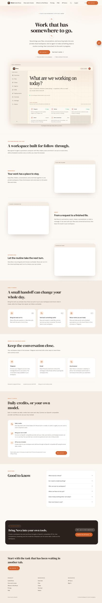

Nova's page is already in the right lane: warm paper base, serif display, ember accent used once, big product capture, connectors row, FAQ. The gap is not the look — it is the middle of the page: no proof band, no clear "how the agent works in three steps", no social proof at all. That is why the top picks are all *section* sources rather than whole-page replacements.

## Judging criteria

1. **Brand fit.** Warm neutral surfaces, one warm accent, restrained type, space over contrast. Any template whose hero is a purple/blue mesh gradient or a neon glow starts at a disadvantage — Nova's brand doc explicitly rejects the "stripes of colour, boxes inside boxes" look.
2. **Stack fit.** Nova is Vite 7 + React 19 + Tailwind 4 + Radix + wouter, with no Motion. Radix/shadcn section code copies in; Next.js code needs `next/link` and `next/image` swapped; Base UI or Motion code needs a new dependency.
3. **Section coverage.** Hero with a real product capture, how-it-works steps, connectors/integrations, proof, pricing, FAQ, final CTA.
4. **Cost and licence.** MIT beats paid unless the design gap is decisive.
5. **Risk.** The waitlist gate on `/sign-in` flips itself on 1 November 2026, so any landing work should leave `SignIn.tsx`, `SignInRoute.tsx` and the date constant untouched.

## What I'd do

1. **Keep Nova's identity and hero.** It fits the brand and it is already live.
2. **Adopt Tailark (Veil) as the section source** — free, MIT, shadcn-native, installs block-by-block. Targets: a three-step "how the agent works", a connectors/bento block for the tools Nova already names, a proof band, and a tighter FAQ.
3. **Reach for Cruip Simple Light as the structural reference** for section order and spacing, and its dark testimonial band as the one high-contrast moment on the page.
4. **If the budget allows one purchase,** Magic UI Pro ($199) for the AI Agent bento and animated proof sections; if the palette matters more than the components, study Orion and rebuild the rhythm by hand.
5. **Ship the pieces through the existing landing folder** (`client/src/pages/landing/`) so the page stays one composition, and restyle anything imported with Nova's tokens rather than the template's palette.

## Also worth looking at (inspiration, not templates)

Curated galleries of light, warm landing pages that match Nova's direction: A1's clean-landing set (Shiori in orange and cream, Clarion in beige, PubQ in white and cream) [^11], and the 2026 "warm cream, serif display, muted earth tones, no WebGL" pattern that the big AI labs have made a positioning signal. [^12]

[^1]: https://github.com/tailark/blocks
[^2]: https://github.com/cruip/tailwind-landing-page-template
[^3]: https://pro.magicui.design/docs/templates/agent
[^4]: https://shadcnstudio.com/templates/orion-ai-agent-template
[^5]: https://github.com/shadcnstore/shadcn-dashboard-landing-template
[^6]: https://www.shadcn.io/template/solaris
[^7]: https://github.com/ColorlibHQ/velora-ui
[^8]: https://github.com/ShadcnDeck/chatdeck-shadcn-saas-landing-page-template
[^9]: https://www.shadcn.io/template/leomirandaa-shadcn-landing-page
[^10]: https://tailwindcss.com/plus
[^11]: https://www.a1.gallery/websites/clean-landing
[^12]: https://toimi.pro/blog/best-saas-website-designs
